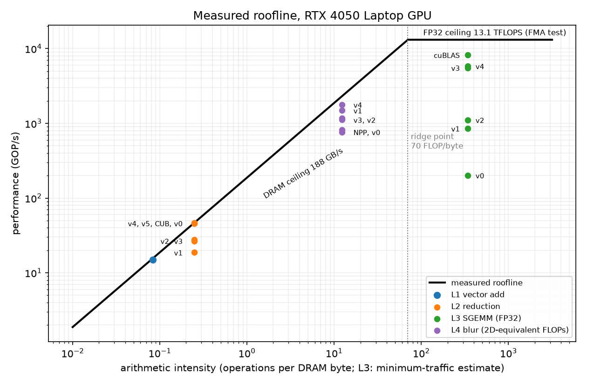
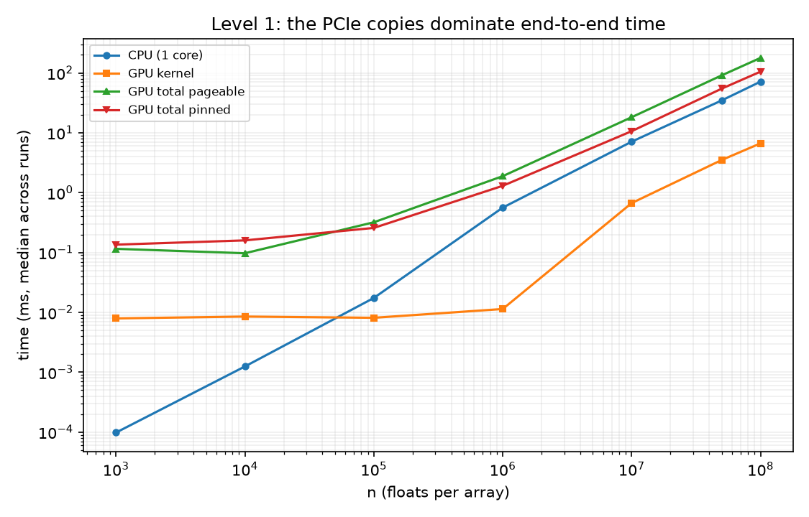
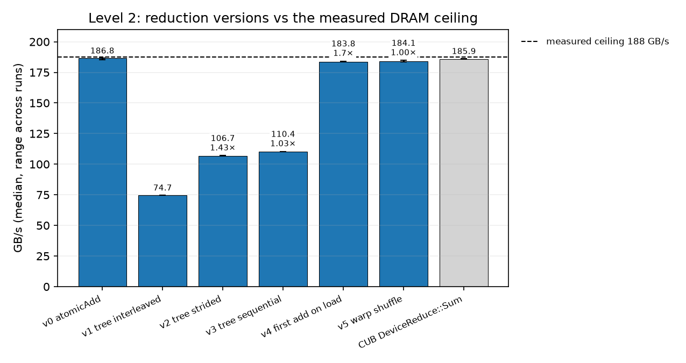
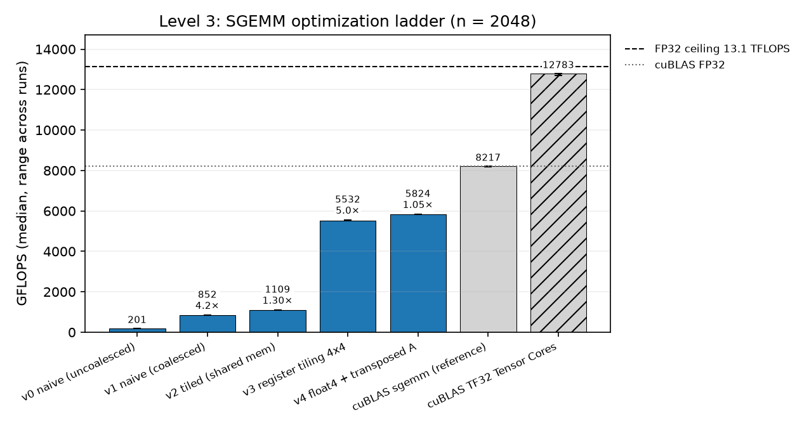
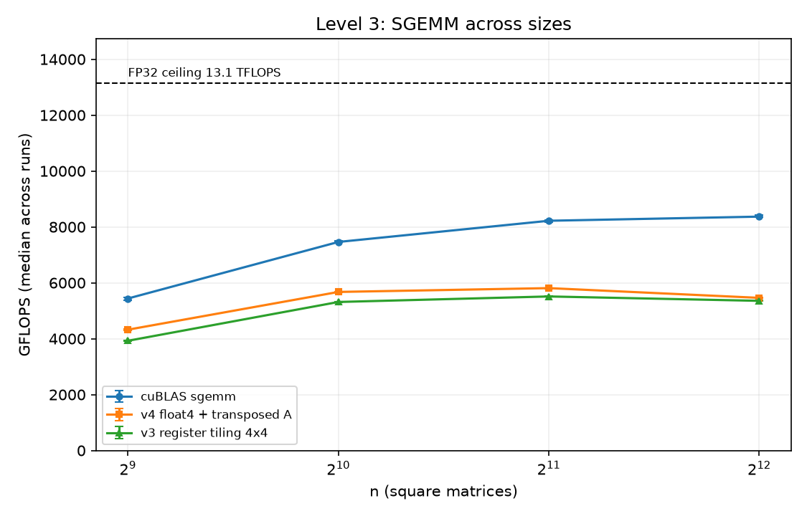
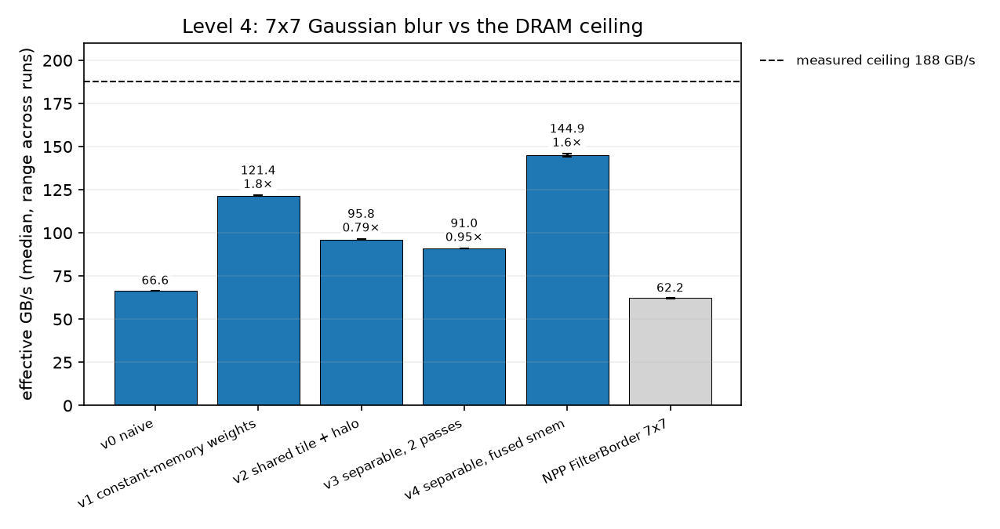
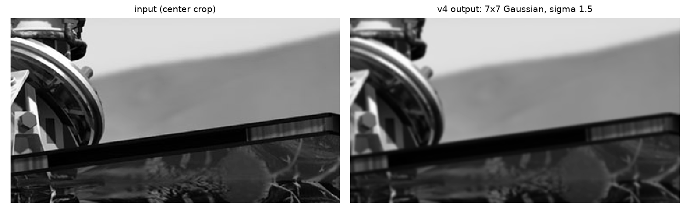

# cuda-kernels-lab

[](https://github.com/Das72K/cuda-kernels-lab/actions/workflows/build.yml)

Hand-written CUDA kernels, built up level by level and benchmarked.

**Target:** NVIDIA GeForce RTX 4050 Laptop GPU (Ada, `sm_89`)

## Layout

```
.
├── bench/                   # peak microbenchmarks (achievable bandwidth and FP32 FMA throughput)
├── CLAUDE.md
├── CMakeLists.txt
├── common/
│   ├── cuda_utils.h         # shared helpers (CUDA_CHECK, GpuTimer)
│   └── bench.h              # benchmark framework: warm-up, median + p10/p90, peaks, CSV
├── data/                    # test_image.png (3840x2160 grayscale input for Level 4)
├── results/                 # env.txt + raw/runN/ (one folder per full benchmark run)
│   ├── raw/runN/            # CSV + console output of each program, one folder per full run
│   ├── tables/              # markdown tables generated by make_plots.py
│   ├── plots/               # PNG plots generated by make_plots.py
│   ├── images/              # output images written by Level 4
│   └── env.txt
├── scripts/
│   ├── run_all.sh           # rebuilds and regenerates every result
│   ├── make_plots.py        # CSVs -> results/tables/, results/plots/, README tables
│   └── requirements.txt     # pandas, matplotlib, numpy, pillow
├── src/
│   ├── level1_vector_add/
│   ├── level2_reduction/
│   ├── level3_matmul/
│   └── level4_image_filter/
└── third_party/             # stb_image.h, stb_image_write.h (public domain / MIT)
```

## Build

```bash
cmake -S . -B build
cmake --build build -j
```

Binaries land in `build/bin/`. Kernels are compiled with `-lineinfo` so Nsight Compute can map metrics back to source.

## Results

<!-- BEGIN:summary -->
| Level | Workload | Bound by | Best own kernel | vs library | vs measured ceiling |
|---|---|---|---|---|---|
| 1 Vector add | 100M floats | memory | 180 GB/s | — | 96% of 188 GB/s |
| 2 Reduction | 33.6M ints | memory | v5: 184 GB/s | 99% of CUB | 98% of 188 GB/s |
| 3 SGEMM | n = 2048, FP32 | compute | v4: 5.82 TFLOPS | 71% of cuBLAS | 44% of 13.1 TFLOPS |
| 4 Gaussian blur 7×7 | 8.3 MP image | memory | v4: 0.46 ms (145 GB/s eff.) | 2.3× NPP speed | 77% of 188 GB/s |

Ceilings measured on this GPU by `bench/peak.cu`: DRAM 187.6 GB/s (best read test), FP32 13.14 TFLOPS (FMA test). All values: median across 3 full runs.
<!-- END:summary -->



### Measured ceilings

<!-- BEGIN:peaks -->
| test | ms (median) | range across runs | result | % of 192 GB/s spec |
|---|---|---|---|---|
| copy (read + write) | 6.130 | 6.124–6.141 | 175.2 GB/s | 91.2% |
| read-only | 2.862 | 2.861–2.863 | 187.6 GB/s | 97.7% |
| copy unrolled x4 | 6.168 | 6.159–6.174 | 174.1 GB/s | 90.7% |
| read-only unrolled x4 | 2.861 | 2.860–2.869 | 187.6 GB/s | 97.7% |
| FMA (FP32) | 2.451 | 2.442–2.453 | 13.14 TFLOPS | — |
<!-- END:peaks -->

## How to reproduce

Every number in this README comes from one command: `./scripts/run_all.sh`
(laptop plugged in, Windows power mode 'Best performance'). It builds in Release, records the
environment in results/env.txt, and runs the full suite 3 times (`RUNS=3`), writing each program's
console output and CSV to results/raw/runN/. Reported numbers are the median across the runs.
Then `.venv/bin/python scripts/make_plots.py` regenerates all tables and plots from those CSVs
(one-time setup: `python3 -m venv .venv && .venv/bin/pip install -r scripts/requirements.txt`).

## Method and measurement pitfalls

Each GPU measurement: a 500 ms time-based warm-up, then 15 timed trials, each auto-calibrated to last at
least 10 ms; each run reports the median and p10/p90. The full suite runs 3 times; README numbers are the
median across runs. All GPU work in a program is measured before any CPU timing. Correctness is checked on
every run against a CPU reference (exact for integers) or cuBLAS (max abs error < 1e-2 for FP32).
Ceilings are measured, not quoted: `bench/peak.cu` gives 188 GB/s (DRAM read) and 13.2 TFLOPS (FP32 FMA).

Pitfalls found and fixed along the way:

| Pitfall | Symptom | Fix |
|---|---|---|
| L2 cache | 12 MB working set showed ~1,070 GB/s, far above the DRAM spec | data much larger than the 24 MB L2 |
| Compiler deleting work | CPU looked ~100× faster | `doNotOptimize` / `asm volatile` barrier |
| Cold GPU | first cuBLAS measurement 2.70 ms instead of 2.09 ms | 500 ms warm-up inside every measurement |
| Shared CPU/GPU power budget | GPU kernels 5–15% slower right after seconds of CPU load | all GPU timing before any CPU timing |
| Wave tail effect | FMA test reached 11.3 TFLOPS instead of 13.1 | launch whole waves (occupancy API) |
| Run-to-run drift | absolute numbers ~5% lower in a late run | 3 full runs; ratios to a same-run reference stay within ±0.1 points |

Limitations: one laptop GPU (RTX 4050 Laptop, 140 W); CPU timings vary by ~10–20% between trials (OS
scheduling, shared power budget); integer reduction only; square matrices only; the SGEMM points on the
roofline use the minimum-traffic estimate of arithmetic intensity (to be replaced by measured DRAM traffic).

## Level 1: Vector Add

The kernel computes `c[i] = a[i] + b[i]`, with one thread per element.

**Test setup:** RTX 4050 Laptop GPU (`sm_89`, 6 GB), CUDA 13.3, WSL Ubuntu 24.04, Release build,
laptop plugged in. CPU baseline = single-threaded loop.

<!-- BEGIN:level1 -->
| n | CPU ms | kernel ms | kernel GB/s | kernel vs CPU | total ms (pageable) | vs CPU | total ms (pinned) | vs CPU | check |
|---|---|---|---|---|---|---|---|---|---|
| 1,000 | 0.0001 | 0.0079 | 1.5 | 0.0× | 0.115 | 0.00× | 0.135 | 0.00× | PASS |
| 10,000 | 0.0012 | 0.0085 | 14.1 | 0.1× | 0.097 | 0.01× | 0.159 | 0.01× | PASS |
| 100,000 | 0.0174 | 0.0081 | 147.9 | 2.1× | 0.320 | 0.05× | 0.257 | 0.07× | PASS |
| 1,000,000 | 0.5619 | 0.0114 | 1055.0 | 49.4× | 1.884 | 0.30× | 1.300 | 0.43× | PASS |
| 10,000,000 | 7.0931 | 0.6690 | 179.4 | 10.6× | 18.184 | 0.39× | 10.623 | 0.67× | PASS |
| 50,000,000 | 34.7206 | 3.5119 | 170.8 | 9.9× | 91.051 | 0.38× | 54.640 | 0.64× | PASS |
| 100,000,000 | 71.5206 | 6.6606 | 180.2 | 10.7× | 178.178 | 0.40× | 105.020 | 0.68× | PASS |
<!-- END:level1 -->



*Median across 3 full runs.*

### Findings

- **The kernel runs at the memory ceiling:** for large arrays (10M–100M) it reaches ~170–180 GB/s, about
  91–96% of the measured 188 GB/s ceiling. At 1M elements it shows ~1,070 GB/s: the 12 MB working set fits
  in the 24 MB L2 cache, so repeated runs read from cache, not DRAM.
- **Speed-up follows the bandwidth ratio:** vector add is memory-bound (12 bytes per addition), so the
  kernel's ~10× advantage over one CPU core matches the ratio of the two memory systems' bandwidths.
  Below ~100K elements the fixed ~8–9 µs launch overhead dominates and the CPU is faster.
- **Transfers dominate end to end:** including PCIe copies, the GPU never beats the CPU (best: ~0.67×).
  Pinned host memory (`cudaMallocHost`) lets the copy engine read directly and raises copy throughput from
  ~7 to ~12 GB/s (~1.7×), but copying 12 bytes per addition still costs more than the addition saves.
  GPUs pay off when data stays on the device or the work per byte is high (Level 3).

### How to run

```bash
cmake -S . -B build && cmake --build build && ./build/bin/level1_vector_add
```

## Level 2: Reduction (sum of 33.5M ints)

The kernels sum n = 2^25 random ints (0–9, fixed seed, 134 MB, larger than L2) on the GPU; ints keep
the result exact, so GPU and CPU must match bit-for-bit.

**Test setup:** same hardware as Level 1; times are the median of 15 trials per run, median across 3 runs;
peak DRAM bandwidth: measured ceilings (see Measured ceilings).

<!-- BEGIN:level2 -->
| version | ms (median) | range across runs | GB/s | % of measured ceiling | % of CUB | check |
|---|---|---|---|---|---|---|
| CPU (1 core) | 11.8881 | 10.7131–12.7918 | 11.3 | — | — | PASS |
| v0 atomicAdd | 0.7186 | 0.7186–0.7237 | 186.8 | 99.5% | 100.5% | PASS |
| v1 tree interleaved | 1.7963 | 1.7929–1.8003 | 74.7 | 39.8% | 40.2% | PASS |
| v2 tree strided | 1.2576 | 1.2544–1.2579 | 106.7 | 56.9% | 57.4% | PASS |
| v3 tree sequential | 1.2160 | 1.2159–1.2194 | 110.4 | 58.8% | 59.3% | PASS |
| v4 first add on load | 0.7303 | 0.7286–0.7305 | 183.8 | 98.0% | 98.9% | PASS |
| v5 warp shuffle | 0.7289 | 0.7265–0.7304 | 184.1 | 98.1% | 99.0% | PASS |
| CUB DeviceReduce::Sum | 0.7221 | 0.7201–0.7228 | 185.9 | 99.1% | 100.0% | PASS |
<!-- END:level2 -->



*Median across 3 full runs; error bars: min–max across runs.*

### Findings

- **Every fast version reaches the ceiling:** v0, v4, v5 and NVIDIA CUB all run at ~185 GB/s, about 99% of
  the measured 188 GB/s DRAM ceiling. Reduction is memory-bound; once a version saturates DRAM, further
  compute optimizations cannot show up (v5's warp shuffle gives 1.00× over v4).
- **Atomics are not automatically slow:** v0 (`atomicAdd` on one counter) matches CUB. The SASS shows why:
  the compiler warp-aggregates the atomics (`REDUX.SUM` + one `RED.E.ADD` per warp), so ~1M atomics reach
  the L2 instead of 33.5M.
- **The tree ladder:** removing warp divergence (v1 → v2) gives 1.43×; removing shared-memory bank conflicts
  (v2 → v3) only 1.03×, because the worst conflicts occur in late rounds with few active threads; loading and
  adding two elements per thread (v3 → v4) gives 1.7× and reaches the ceiling. The biggest win came from
  more work per thread, not from polishing the compute.

### How to run

```bash
./build/bin/level2_reduction
```

## Level 3: Matrix multiplication (SGEMM, FP32)

The kernels compute C = A·B for square FP32 matrices, n = 2048 (17.18 GFLOP), with random values in
[-1, 1] (fixed seed); correctness is checked against cuBLAS with max abs error < 1e-2.

**Test setup:** same hardware as Level 1; GPU times are the median of 15 trials per run, median across 3 runs,
after a 500 ms GPU warm-up; CPU baseline: 5 trials of one run each, timed after all GPU measurements (single-threaded i-k-j loop).

<!-- BEGIN:level3 -->
| version | ms (median) | range across runs | GFLOPS | % of FP32 ceiling | % of cuBLAS | max err | check |
|---|---|---|---|---|---|---|---|
| CPU (1 core, ikj) | 2338.222 | 2236.766–2392.701 | 7 | — | — | 3.8e-05 | PASS |
| v0 naive (uncoalesced) | 85.549 | 85.089–85.564 | 201 | 1.5% | 2.4% | 0.0e+00 | PASS |
| v1 naive (coalesced) | 20.168 | 20.105–20.182 | 852 | 6.5% | 10.4% | 0.0e+00 | PASS |
| v2 tiled (shared mem) | 15.489 | 15.489–15.500 | 1109 | 8.4% | 13.5% | 0.0e+00 | PASS |
| v3 register tiling 4x4 | 3.106 | 3.089–3.107 | 5532 | 42.1% | 67.3% | 0.0e+00 | PASS |
| v4 float4 + transposed A | 2.950 | 2.939–2.951 | 5824 | 44.3% | 70.9% | 0.0e+00 | PASS |
| cuBLAS sgemm (reference) | 2.091 | 2.089–2.100 | 8217 | 62.5% | 100.0% | 0.0e+00 | PASS |
| cuBLAS TF32 Tensor Cores | 1.344 | 1.342–1.353 | 12783 | — | 155.4% | 2.0e-02 | PASS |
<!-- END:level3 -->

Size sweep: GFLOPS (% of cuBLAS)

<!-- BEGIN:level3_sweep -->
| n | cuBLAS GFLOPS | v3 GFLOPS (% cuBLAS) | v4 GFLOPS (% cuBLAS) | check |
|---|---|---|---|---|
| 512 | 5439 | 3926 (72.1%) | 4323 (79.0%) | PASS |
| 1024 | 7462 | 5314 (71.3%) | 5673 (76.0%) | PASS |
| 2048 | 8220 | 5512 (67.2%) | 5810 (70.6%) | PASS |
| 4096 | 8368 | 5355 (64.0%) | 5461 (65.3%) | PASS |
<!-- END:level3_sweep -->



*Median across 3 full runs; error bars: min–max across runs.*



*Median across 3 full runs; error bars: min–max across runs.*

### Findings

- **The optimization ladder:** coalescing (v0 → v1) 4.2×; shared-memory tiling (v1 → v2) only 1.30×, because
  the inner loop then needs two shared-memory loads per FMA and the bottleneck moves to shared memory;
  2D register tiling with a 4×4 outer product per thread (v2 → v3) 5.0×; vectorized `float4` shared loads
  with a transposed, padded A tile (v3 → v4) 1.05×, consistent in all 3 runs.
- **Where v4 stands:** ~5.8 TFLOPS, ~71% of cuBLAS FP32 and ~44% of the measured 13.2 TFLOPS FP32 ceiling
  (cuBLAS itself reaches ~63%). The gap to cuBLAS grows with size, from ~79% at n = 512 to ~65% at
  n = 4096; larger per-thread tiles and double buffering are the likely difference (to be confirmed with
  Nsight Compute).
- **Tensor Cores:** cuBLAS in TF32 mode reaches ~12.8 TFLOPS (~1.55× FP32 cuBLAS) at the cost of precision
  (max error 2e-2 vs 0 for FP32).
- **Exact match with cuBLAS:** v0–v4 match cuBLAS bit for bit (max error 0) because they accumulate each
  output in the same k order with fused multiply-adds; the CPU loop does not fuse and differs by ~4e-5.

### How to run

```bash
./build/bin/level3_matmul
```

## Level 4: Gaussian blur (7x7, 3840x2160 image)

The kernels apply a 7x7 Gaussian blur (sigma 1.5, clamp-to-edge borders) to a 3840x2160 grayscale image
(NASA/JPL-Caltech PIA04413, see [data/README.md](data/README.md)); correctness is checked against a CPU
reference with max abs error < 1e-4.

**Test setup:** same hardware as Level 1; median of 15 trials per run, median across 3 runs; "effective" GB/s
and GFLOPS divide the ideal work (8 bytes and 49 multiply-adds per pixel) by the time, so all versions are
compared on the same job; the library reference is NPP `nppiFilterBorder_32f_C1R` (general 7x7 filter).

<!-- BEGIN:level4 -->
| version | ms (median) | range across runs | effective GB/s | % of DRAM ceiling | % of NPP speed | max err | check |
|---|---|---|---|---|---|---|---|
| CPU (1 core) | 194.462 | 194.404–195.365 | 0.3 | — | — | 0.0e+00 | PASS |
| v0 naive | 0.997 | 0.997–1.000 | 66.6 | 35.5% | 106.9% | 3.0e-07 | PASS |
| v1 constant-memory weights | 0.546 | 0.545–0.547 | 121.4 | 64.7% | 195.4% | 3.0e-07 | PASS |
| v2 shared tile + halo | 0.692 | 0.688–0.693 | 95.8 | 51.1% | 154.3% | 3.0e-07 | PASS |
| v3 separable, 2 passes | 0.729 | 0.729–0.731 | 91.0 | 48.5% | 146.2% | 4.8e-07 | PASS |
| v4 separable, fused smem | 0.458 | 0.455–0.461 | 144.9 | 77.2% | 232.7% | 4.8e-07 | PASS |
| NPP FilterBorder 7x7 | 1.066 | 1.066–1.068 | 62.2 | 33.2% | 100.0% | 3.0e-07 | PASS |
<!-- END:level4 -->



*Median across 3 full runs; error bars: min–max across runs.*



### Findings

- **Overall:** the best version (v4) blurs the 8.3 MP image in ~0.46 ms: ~425× one CPU core, ~2.3× faster than
  NPP's general 7×7 filter, and at ~77% of the memory floor (8 bytes per pixel at the measured 188 GB/s ceiling).
- **Constant memory (v0 → v1, 1.8×):** v0 is not limited by DRAM (36% of the ceiling) but by load
  instructions: two per tap (weight + pixel). With the weights in `__constant__` memory, the SASS shows them as
  constant-bank operands of the `FFMA` instructions, so the weight loads disappear and the global loads per tap
  halve.
- **Shared-memory tiling did not help (v1 → v2, 0.79×):** v2 still reads 49 values per output, now from shared
  memory instead of L1-cache hits, which on this GPU are equally fast (same on-chip hardware). Tiling reduces
  memory traffic, but v1's bottleneck was load instructions, not traffic; the tile load, barrier and halo only
  added cost. A documented negative result.
- **Separable in two passes did not help either (v3, 0.95× vs v2):** a 7×7 Gaussian equals a 7-tap horizontal
  pass followed by a 7-tap vertical pass (14 taps instead of 49), but the intermediate image goes through DRAM,
  doubling the traffic to 16 bytes per pixel. That predicts at least ~0.71 ms before running; v3 measured
  0.73 ms, about 97% of the DRAM ceiling in real traffic: memory-bound, as predicted.
- **Combining both ideas wins (v4, 1.6× vs v3, 1.19× vs v1):** v4 performs the separable blur inside one kernel
  through shared memory: the tile is loaded once (8 bytes per pixel) and each output needs about 19 taps. The
  remaining gap to the floor comes mainly from the halo (14 rows are filtered horizontally to produce 8) and two
  barriers per block.
- **Specialized vs general:** NPP's `nppiFilterBorder_32f_C1R` accepts any 7×7 kernel, so it must apply all 49
  taps; it runs at about the speed of the naive v0. v4 is faster because it knows the filter is a separable
  Gaussian, so this compares a specialized kernel with a general library routine, not two equivalent
  implementations.
- **Metric note:** "effective" GB/s and GFLOPS divide the ideal work (8 bytes, 49 multiply-adds per pixel) by
  the time, so every version is compared on the same job; v3 and v4 actually perform fewer FLOPs, and v3 moves
  more bytes.

### How to run

```bash
./build/bin/level4_image_filter
```

## How this project was built

The code was developed with AI assistance (Claude), acting as a mentor and pair programmer.
All experiments were run on my hardware, and I verified, analyzed and interpreted every result;
I can explain every design decision.
