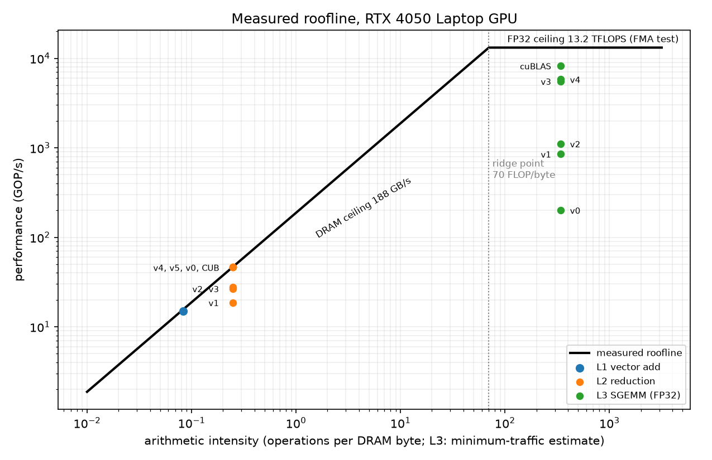
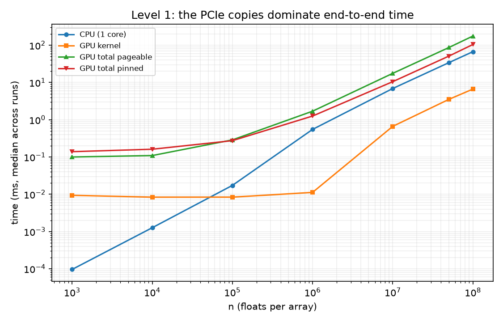
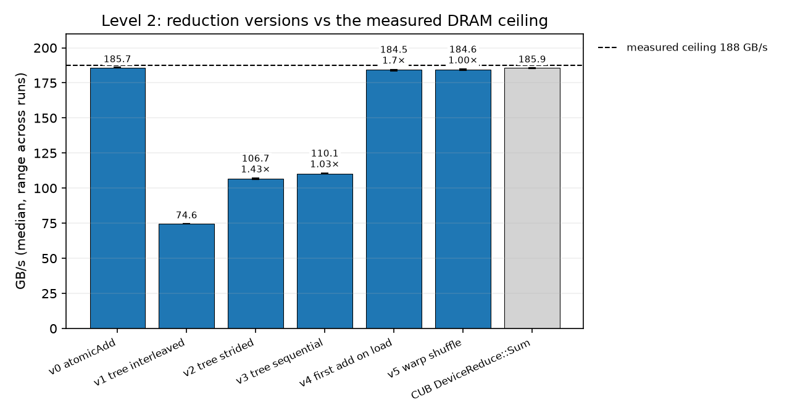
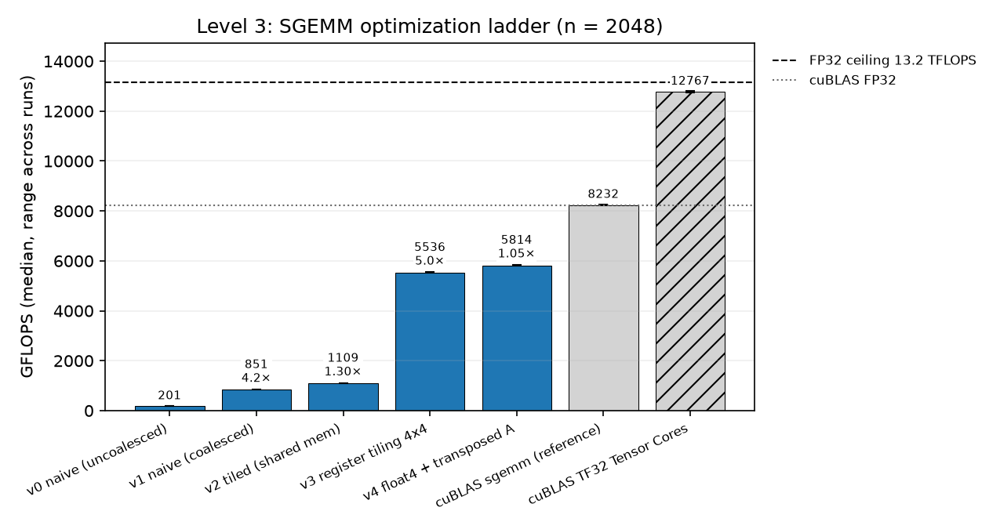
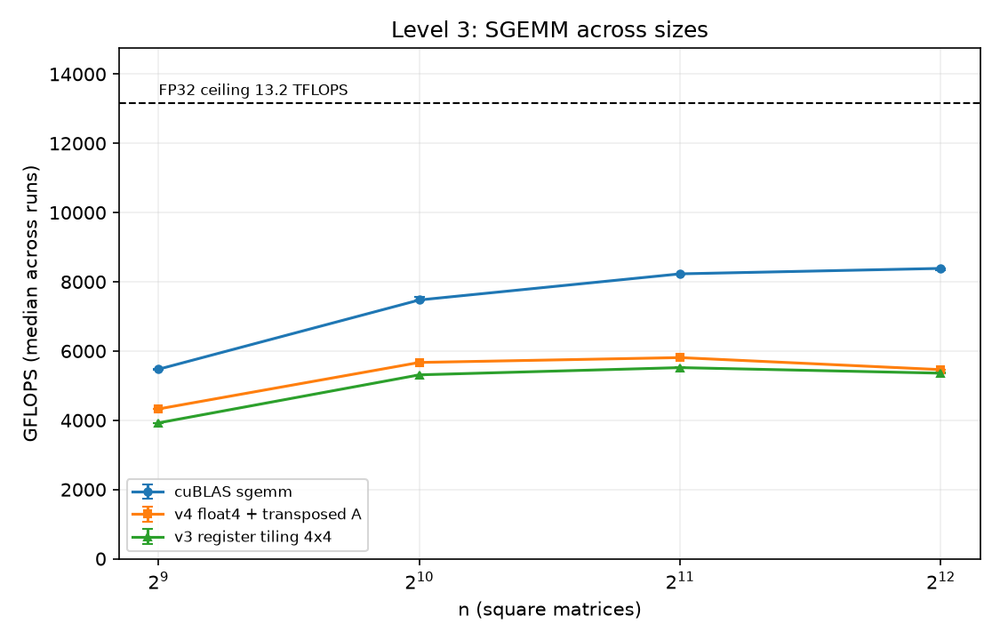

# cuda-kernels-lab

[](https://github.com/Das72K/cuda-kernels-lab/actions/workflows/build.yml)

Hand-written CUDA kernels, built up level by level and benchmarked.

**Target:** NVIDIA GeForce RTX 4050 Laptop GPU (Ada, `sm_89`)

## Layout

```
.
├── bench/                   # peak microbenchmarks (achievable bandwidth and FP32 FMA throughput)
├── CLAUDE.md
├── CMakeLists.txt
├── common/
│   ├── cuda_utils.h         # shared helpers (CUDA_CHECK, GpuTimer)
│   └── bench.h              # benchmark framework: warm-up, median + p10/p90, peaks, CSV
├── results/                 # env.txt + raw/runN/ (one folder per full benchmark run)
│   ├── raw/runN/            # CSV + console output of each program, one folder per full run
│   ├── tables/              # markdown tables generated by make_plots.py
│   ├── plots/               # PNG plots generated by make_plots.py
│   └── env.txt
├── scripts/
│   ├── run_all.sh           # rebuilds and regenerates every result
│   ├── make_plots.py        # CSVs -> results/tables/, results/plots/, README tables
│   └── requirements.txt     # pandas, matplotlib, numpy
└── src/
    ├── level1_vector_add/
    ├── level2_reduction/
    └── level3_matmul/
```

## Build

```bash
cmake -S . -B build
cmake --build build -j
```

Binaries land in `build/bin/`. Kernels are compiled with `-lineinfo` so Nsight Compute can map metrics back to source.

## Results

<!-- BEGIN:summary -->
<!-- END:summary -->



### Measured ceilings

<!-- BEGIN:peaks -->
<!-- END:peaks -->

## How to reproduce

Every number in this README comes from one command: `./scripts/run_all.sh`
(laptop plugged in, Windows power mode 'Best performance'). It builds in Release, records the
environment in results/env.txt, and runs the full suite 3 times (`RUNS=3`), writing each program's
console output and CSV to results/raw/runN/. Reported numbers are the median across the runs.
Then `.venv/bin/python scripts/make_plots.py` regenerates all tables and plots from those CSVs
(one-time setup: `python3 -m venv .venv && .venv/bin/pip install -r scripts/requirements.txt`).

## Level 1: Vector Add

The kernel computes `c[i] = a[i] + b[i]`, with one thread per element.

**Test setup:** RTX 4050 Laptop GPU (`sm_89`, 6 GB), CUDA 13.3, WSL Ubuntu 24.04, Release build,
laptop plugged in. CPU baseline = single-threaded loop.

<!-- BEGIN:level1 -->
<!-- END:level1 -->



### Findings

- **Kernel bandwidth and the L2 cache effect:** For large arrays (10M–50M elements) the kernel
  reaches ~170 GB/s, ~89% of the RTX 4050 Laptop's 192 GB/s (spec) VRAM bandwidth. At 1M elements
  the measured "bandwidth" (~500–750 GB/s) exceeds the VRAM limit: the 12 MB working set fits in
  the L2 cache, so repeated runs read from cache, not VRAM. Benchmarks must use data larger than
  L2 to measure real memory bandwidth.

- **Kernel vs CPU speed-up:** Vector add is memory-bound (12 bytes moved per addition), so the
  speed-up is set by the ratio of memory bandwidths: ~170 GB/s on the GPU vs ~14 GB/s for one CPU
  core gives the measured 10–14×. Below ~100K elements the fixed launch overhead (~10–20 µs, varies between runs) dominates and the
  CPU is faster.

- **Transfers dominate (pageable vs pinned):** Including host↔device copies, the GPU never beats
  the CPU. Pageable copies run at ~4.5–5 GB/s because the driver stages them through a page-locked
  buffer; pinned memory (`cudaMallocHost`) lets the copy engine read directly and raises copy throughput
  ~2.5× to ~11–12 GB/s (2.4× faster total at 10M–50M). Even then the best result is 0.91× the CPU: copying
  over PCIe costs more than the single addition it enables. GPUs pay off when data stays on the
  device or the work per byte is high (the goal of Level 3, matrix multiplication).

- **Laptop noise and throttling:** Short runs (<100 µs) vary between runs due to GPU clock changes.
  At 100M the kernel dropped to ~134 GB/s, consistent with the laptop GPU lowering clocks under
  sustained load. A CPU-side gotcha: in Release builds the compiler removed repeated identical CPU
  runs, making the CPU look ~100× faster; an `asm volatile("" ::: "memory")` barrier forces every
  repeat to execute.

### How to run

```bash
cmake -S . -B build && cmake --build build && ./build/bin/level1_vector_add
```

## Level 2: Reduction (sum of 33.5M ints)

The kernels sum n = 2^25 random ints (0–9, fixed seed, 134 MB, larger than L2) on the GPU; ints keep
the result exact, so GPU and CPU must match bit-for-bit.

**Test setup:** same hardware as Level 1; times are the median of 7 trials; peak DRAM bandwidth
(spec) 192 GB/s.

<!-- BEGIN:level2 -->
<!-- END:level2 -->



### Findings

- **Atomics are not automatically slow:** v0 (`atomicAdd` on one counter) runs at 186.5 GB/s.
  The SASS shows why: the compiler warp-aggregates the atomics (`REDUX.SUM` + one `RED.E.ADD`
  per warp), so ~1M atomics reach the L2 instead of 33.5M.
- **Warp divergence (v1 → v2, 1.71×):** v1 picks working threads with `tid % (2*s) == 0`,
  leaving half of every warp idle; v2 packs the work onto contiguous threads so whole warps
  are either busy or skipped, and drops the slow modulo.
- **Bank conflicts (v2 → v3, 1.04×):** v2's strided shared-memory access causes 2-way and
  higher bank conflicts; v3's "fold in half" addressing removes them. On this GPU the gain is
  small, because the worst conflicts occur in late rounds when few threads are active.
- **More work per thread (v3 → v4, 1.65×):** loading and adding two elements per thread
  removes the idle first round and halves the number of blocks; v4 reaches 183.8 GB/s.
- **The memory roofline:** v0, v4, v5 and NVIDIA's CUB all land at 184–187 GB/s, about 97%
  of the 192 GB/s spec. Reduction is memory-bound, so once a version hits this ceiling,
  compute optimizations stop showing up: the warp-shuffle v5 is no faster than v4, and a
  further grid-stride version was not added because there is nothing left to gain here.
- **Measuring honestly:** with a single timed batch, v1–v3 varied by up to ~30% between runs,
  while the memory-bound versions did not. These kernels depend on the boosting SM clock;
  reporting the median of 7 trials made the results stable.

### How to run

```bash
./build/bin/level2_reduction
```

## Level 3: Matrix multiplication (SGEMM, FP32)

The kernels compute C = A·B for square FP32 matrices, n = 2048 (17.18 GFLOP), with random values in
[-1, 1] (fixed seed); correctness is checked against cuBLAS with max abs error < 1e-2.

**Test setup:** same hardware as Level 1; GPU times are the median of 7 trials after a 500 ms GPU
warm-up; CPU is a single run (single-threaded i-k-j loop).

<!-- BEGIN:level3 -->
<!-- END:level3 -->

Size sweep: GFLOPS (% of cuBLAS)

<!-- BEGIN:level3_sweep -->
<!-- END:level3_sweep -->





### Findings

- **Coalescing (v0 → v1, 4.2×):** the only change is which thread index maps to rows and which to
  columns. With `threadIdx.x` on columns, a warp reads consecutive addresses of B and C; with it on
  rows, every thread touches a different 8 KB-apart row.
- **Shared-memory tiling (v1 → v2, only 1.3×):** tiling cuts global-memory traffic 16×, but the inner
  loop then needs two shared-memory loads per FMA. Shared memory serves roughly one warp-load per cycle
  while the SM can issue four warp-FMAs, so the bottleneck moved from DRAM to shared memory.
- **Register tiling (v2 → v3, 5.0×):** each thread computes a 4×4 block of C as an outer product of
  4 A values and 4 B values held in registers: 8 shared loads per 16 FMAs instead of 2 per 1.
  v3 reaches 5.55 TFLOPS, 67.5% of cuBLAS.
- **Vectorized shared loads (v3 → v4, 1.05×):** storing the A tile transposed (padded by 4 floats to
  avoid bank conflicts) allows two `float4` loads per k-step instead of eight scalar loads.
  v4 reaches 5.82 TFLOPS, 70.8% of cuBLAS.
- **The gap to cuBLAS grows with size:** v4 is at 82% of cuBLAS at n = 512 but 65% at n = 4096.
  cuBLAS keeps scaling while v4 peaks at n = 2048; larger per-thread tiles and double buffering
  (not implemented) are the likely difference, to be confirmed with Nsight Compute.
- **Tensor Cores:** cuBLAS in TF32 mode reaches 12.7 TFLOPS (1.54× FP32 cuBLAS) at the cost of
  precision (max error 2.0e-2 vs 0 for FP32).
- **A measurement pitfall:** without a warm-up, the first cuBLAS run (after the multi-second CPU
  baseline left the GPU idle and down-clocked) measured 2.70 ms instead of 2.09 ms, making every
  kernel look ~20 percentage points closer to cuBLAS than it is. A 500 ms warm-up fixed it.

### How to run

```bash
./build/bin/level3_matmul
```

## How this project was built

The code was developed with AI assistance (Claude), acting as a mentor and pair programmer.
All experiments were run on my hardware, and I verified, analyzed and interpreted every result;
I can explain every design decision.
